# PixVault - Private Image Studio

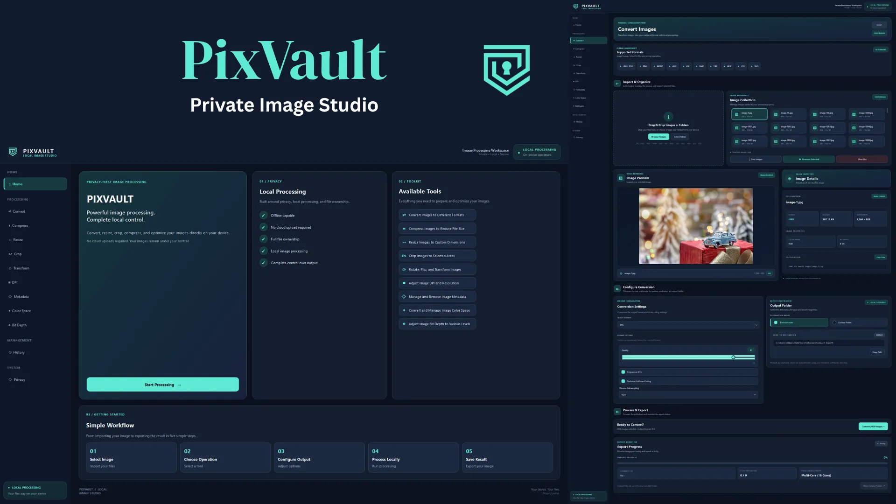


## Project Overview

PixVault is a privacy-first Python desktop application built with PySide6 for local image conversion, optimization, transformation, and technical asset preparation without uploading files to external servers or cloud services. Designed for photographers, developers, designers, and privacy-conscious users, it replaces web-based converters by executing every image pipeline stage directly on the user's machine. Its modular processing engine supports multi-core batch execution across large collections while preserving strict local file ownership and transparent activity logging.

## Key Features

- **100% Local & Offline Processing**: Executes all decoding, transformation, encoding, and metadata inspection tasks entirely on-device with zero network or cloud dependencies.
- **Multi-Format Conversion**: Supports importing 14 formats (including JPG, PNG, WebP, AVIF, GIF, SVG, BMP, TIFF, HEIC/HEIF, ICO, and RAW) and exporting to 10 output formats (`JPEG`, `PNG`, `WebP`, `AVIF`, `GIF`, `SVG`, `BMP`, `TIFF`, `HEIC`, and `ICO`).
- **Quality & Target-Size Compression**: Provides slider-based quality compression alongside iterative target file-size optimization (KB/MB) with `size`, `balanced`, and `quality` priority steps.
- **Precision Geometry Tools**: Includes 6 resize modes (`exact`, `width`, `height`, `percentage`, `longest_side`, `shortest_side`) with Lanczos/Bicubic/Bilinear/Nearest resampling, 4 crop modes (`aspect_ratio`, `fixed_dimensions`, `percentage`, `coordinates`), and rotation/flip transformations.
- **Print DPI & Color Management**: Configures horizontal/vertical DPI or DPCM print density and performs ICC color profile transforms across `sRGB`, `Adobe RGB`, `Display P3`, `CMYK (FOGRA39)`, and `Grayscale` with selectable rendering intents.
- **High Bit-Depth Encoding**: Supports true 8-bit and 16-bit per-channel PNG output via a custom chunk writer, plus 8-bit, 16-bit, and 32-bit floating-point TIFF output backed by `tifffile` and `NumPy`.
- **Metadata Privacy Stripping**: Clears all embedded tags or selectively removes EXIF, GPS coordinates, XMP, IPTC, ICC profiles, software tags, copyright fields, and camera maker notes.
- **Multi-Core Batch Engine & Collision-Free Naming**: Processes large image queues in parallel across logical CPU cores using `ProcessPoolExecutor` and `QThread` workers, with pre-allocated collision-safe filenames and live progress/cancellation controls.
- **Local Activity History**: Tracks all processed jobs with timestamps, source/output paths, formats, operations, and failure diagnostics stored atomically in local JSON.

## Supported Platforms

| Platform | Operating System | Minimum Version | Support / Test Status |
| :--- | :--- | :--- | :--- |
| Windows Desktop | Windows (64-bit) | Windows 10 (x64) | Configured, Packaged (`dist/PixVault.exe`), & Self-Tested |

## Tech Stack

| Category | Technology | Purpose |
| :--- | :--- | :--- |
| Programming Language | Python | Core application runtime, image pipeline, and multiprocessing logic |
| GUI Framework | PySide6 | Native desktop window, dark studio UI, stacked pages, and Qt SVG rasterization |
| Core Image Engine | Pillow | Image decoding, resizing, cropping, rotation, ICC transforms (`ImageCms`), and standard encoders |
| Numerical Computing | NumPy | High-precision 16-bit and 32-bit pixel array scaling for PNG and TIFF encoders |
| Next-Gen Codecs | pillow-heif | HEIC/HEIF decoding and 8/10-bit encoding in main and worker processes |
| Next-Gen Codecs | pillow-avif-plugin | AVIF decoding and lossy/lossless encoding support |
| High-Bit TIFF | tifffile | Writing 16-bit integer and 32-bit floating-point multichannel TIFF images |
| RAW & Vector Support | rawpy / svgwrite | RAW camera image support and SVG document export packaging |
| Concurrency | concurrent.futures / QThread | Multi-core `ProcessPoolExecutor` batch execution bridged to non-blocking Qt UI signals |
| Persistence | JSON | Atomic temporary-file writes to local `history.json` records |
| Packaging | PyInstaller | Single-file Windows executable (`PixVault.exe`) bundling ICC profiles and native codec DLLs |

## Application Architecture

PixVault follows a decoupled layered desktop architecture separating presentation (`ui/`), service orchestration (`services/`), concurrent execution (`core/`), domain processors (`processing/`), format encoders (`formats/`), export management (`export/`), and local persistence (`history/`). User actions in `MainWindow` and `Workspace` dispatch jobs through `BatchService` into a Qt `WorkerThread`, which coordinates a `BatchWorker` `ProcessPoolExecutor` that executes `ImagePipeline` deterministically across ordered stages before invoking `Exporter` and recording results via `HistoryManager`.

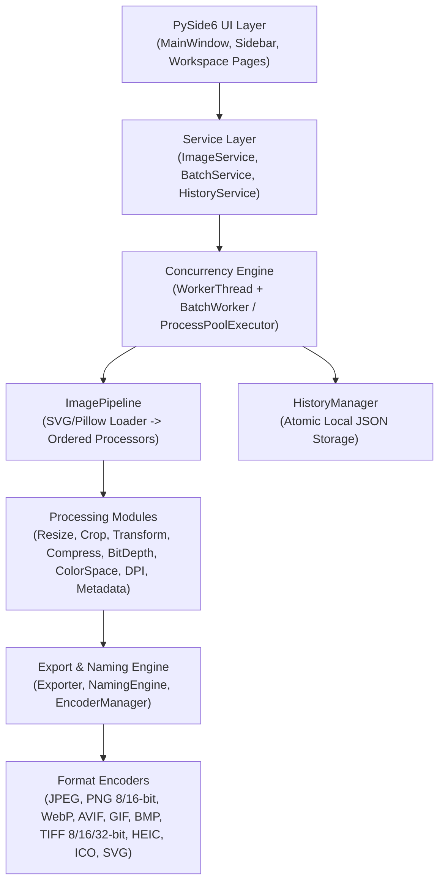

## Screenshots / Preview

### 1. Home Dashboard & Studio Overview
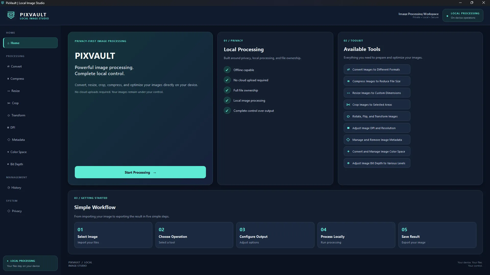
The landing screen introduces PixVault's privacy-first local processing model, summarizes the nine dedicated processing tools in the toolkit card, and displays a five-step getting-started workflow alongside the persistent left navigation sidebar and local status indicator.

### 2. Privacy & Local File Lifecycle
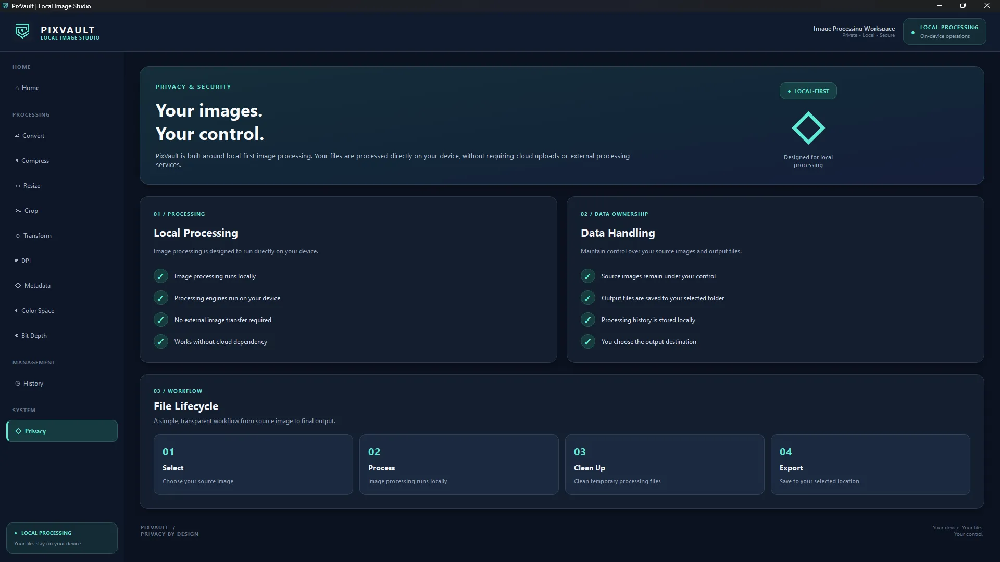
The Privacy view documents the application's on-device execution guarantees, detailing local processing isolation, user-controlled output destinations, and the four-stage file lifecycle from selection to cleanup and export.

### 3. Processing History & Activity Center
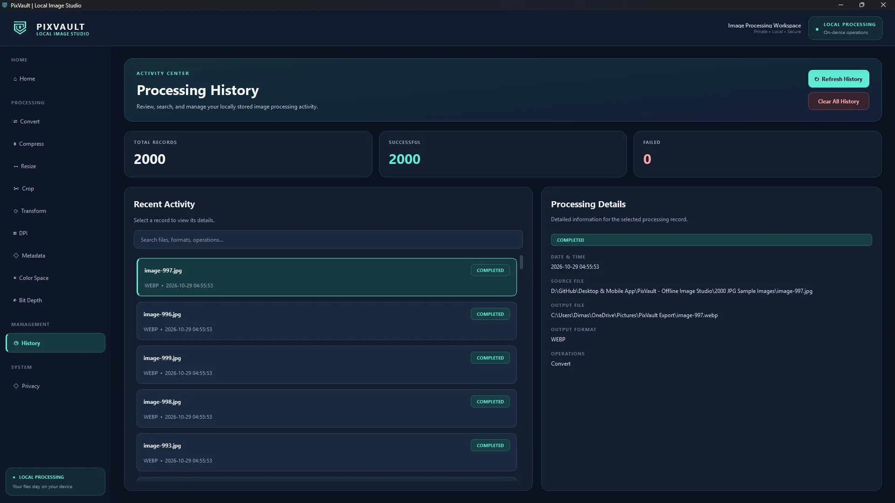
The History page provides summary counters for total, successful, and failed operations alongside a searchable activity log and a right-hand inspection panel showing timestamps, source paths, output paths, target formats, and applied operations.

### 4. Batch Import, Preview & Export Queue
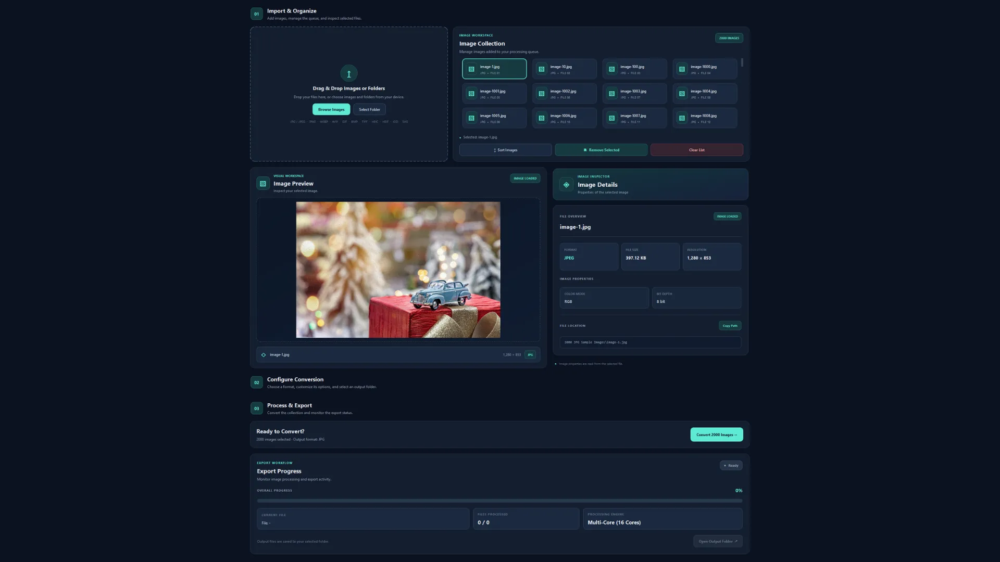
The shared workspace import section combines drag-and-drop or folder selection with a multi-file collection grid, an interactive image preview canvas, a file inspector displaying format, file size, resolution, color mode, and bit depth, and a multi-core export progress monitor.

### 5. Format Conversion Studio
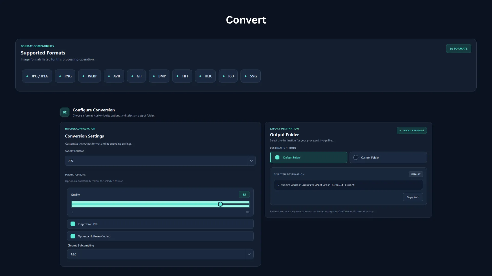
The Convert page displays compatibility badges for all 10 supported output formats and pairs dynamic encoder controls (such as JPEG quality, progressive encoding, Huffman optimization, and chroma subsampling) with the default or custom output folder selector.

### 6. Image Compression Controls
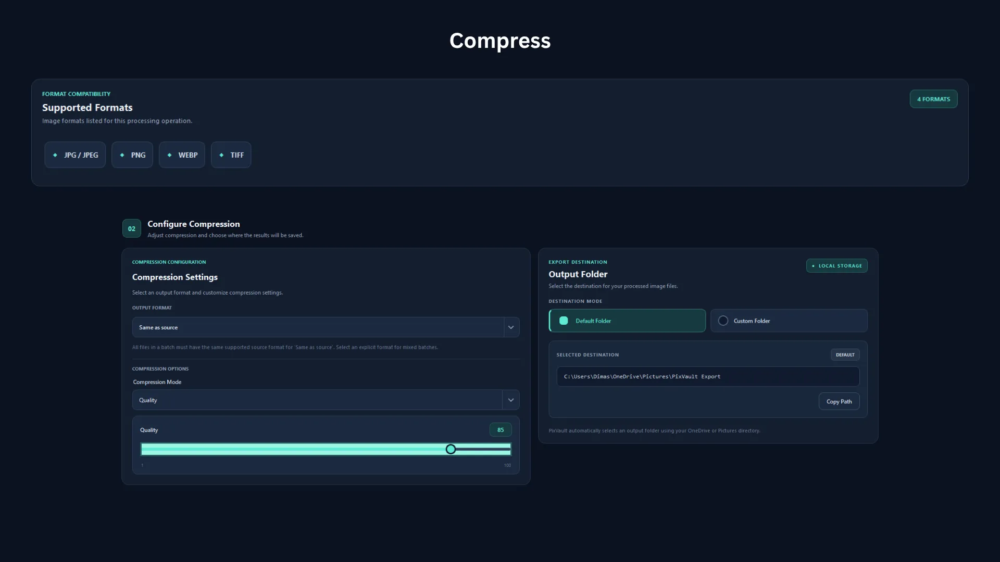
The Compress workspace targets JPEG, PNG, WebP, and TIFF outputs, allowing users to preserve the source format or choose an explicit target while switching between quality-slider compression and target file-size optimization.

### 7. Image Resize & Resampling
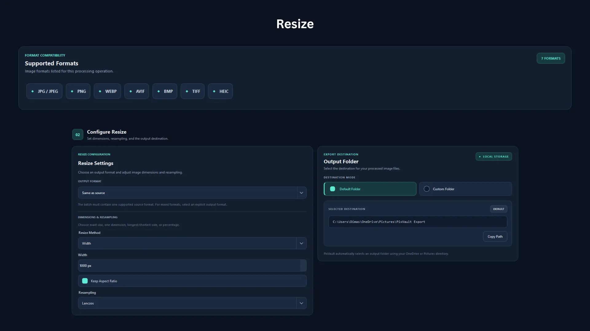
The Resize tool supports seven output formats with selectable scaling methods (`Exact Dimensions`, `Width`, `Height`, `Longest Side`, `Shortest Side`, and `Percentage`), aspect-ratio locking, and selectable interpolation kernels including Lanczos.

### 8. Aspect Ratio & Coordinate Cropping
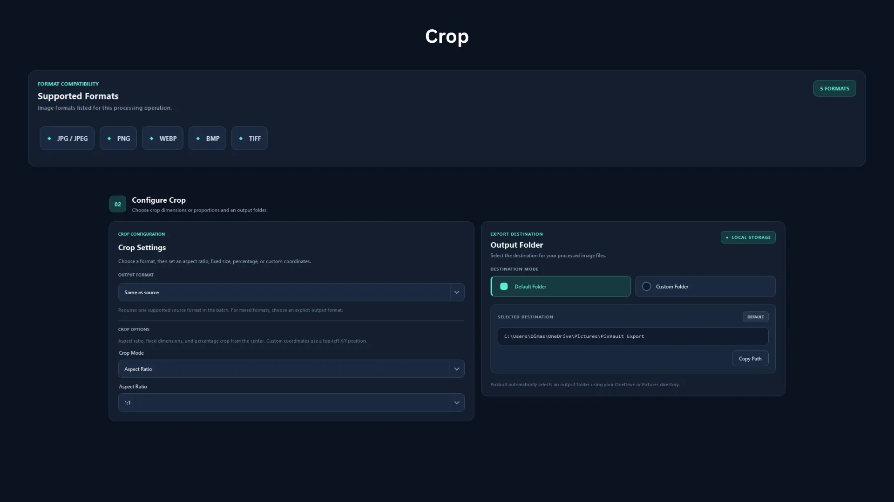
The Crop page provides centered and coordinate-based cropping across five raster formats, letting users choose between preset aspect ratios, fixed pixel dimensions, percentage scaling, or explicit top-left X/Y coordinates.

### 9. Rotation & Flip Transformations
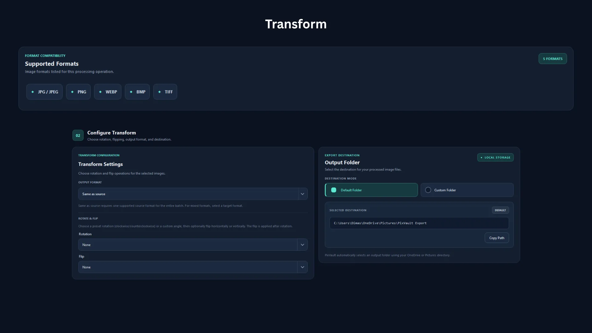
The Transform workspace applies preset or custom-angle rotations and horizontal, vertical, or combined flips across five supported raster formats before writing to the configured export directory.

### 10. Print Density & DPI Configuration
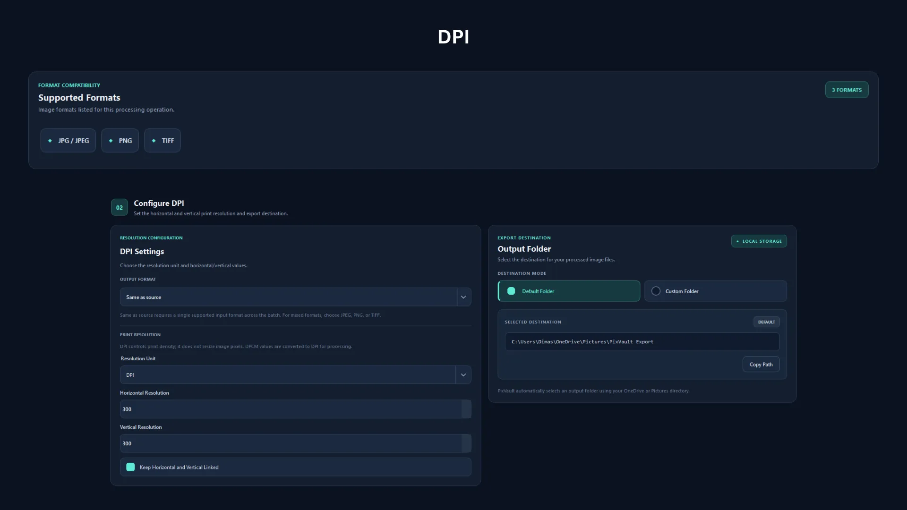
The DPI page adjusts horizontal and vertical print resolution metadata in either `DPI` or `DPCM` units for JPEG, PNG, and TIFF files without altering pixel dimensions, with linked-axis toggling for uniform scaling.

### 11. Metadata Removal & Privacy Stripping
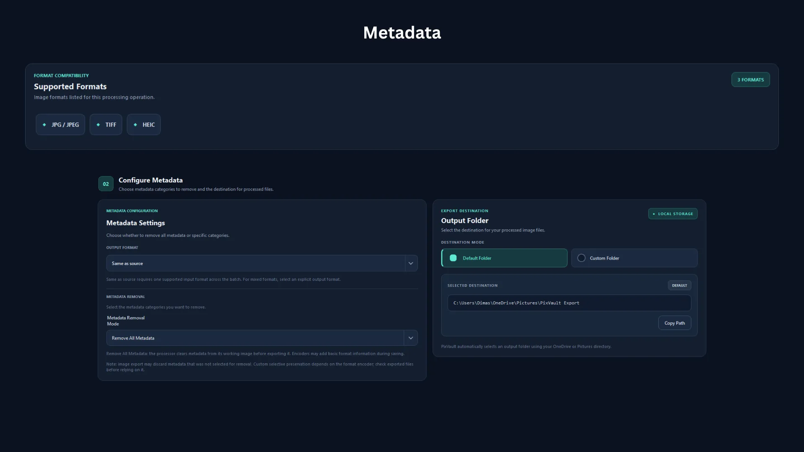
The Metadata module lets users strip all embedded file metadata or selectively target EXIF, GPS, XMP, IPTC, ICC profile, software, copyright, and maker note tags across JPEG, TIFF, and HEIC exports.

### 12. ICC Color Space Management
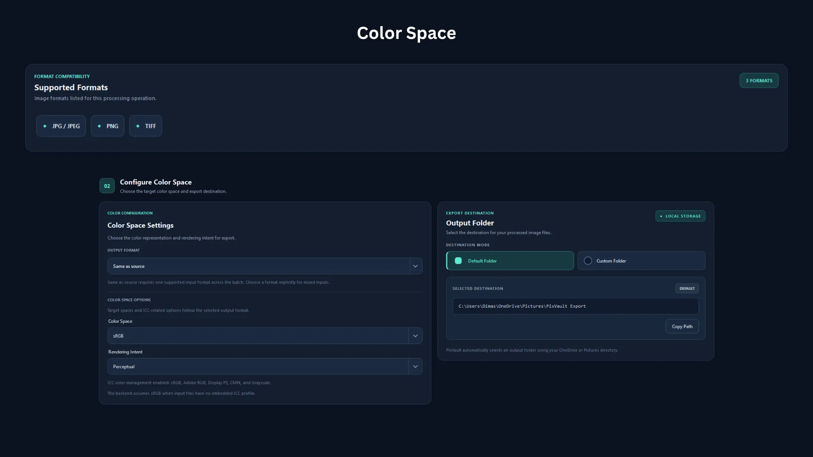
The Color Space workspace converts images between bundled ICC profiles (`sRGB`, `Adobe RGB`, `Display P3`, `CMYK`, and `Grayscale`) with selectable rendering intents (`Perceptual`, `Relative Colorimetric`, `Saturation`, and `Absolute Colorimetric`).

### 13. Pixel Bit Depth Precision
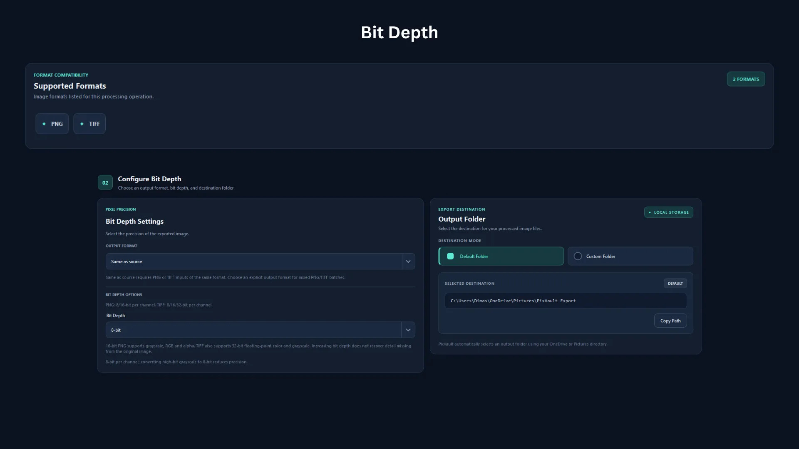
The Bit Depth tool configures sample precision for PNG (8-bit and 16-bit per channel) and TIFF (8-bit, 16-bit, and 32-bit floating-point per channel) workflows, routing high-bit payloads directly to specialized encoders.

## Prerequisites

- **End Users (Prebuilt Executable)**:
  - Windows 10 or Windows 11 (64-bit).
- **Developers (Running or Building from Source)**:
  - Python 3.10 or newer (developed and bundled on Windows 64-bit).
  - `pip` and `venv` for dependency isolation.
  - PyInstaller (required only when building `PixVault.exe`).

## Installation & Setup

1. Clone the repository and enter the project directory:
   ```bash
   git clone https://github.com/weztcy/PixVault-Private-Image-Studio.git
   cd "PixVault - Private Image Studio"
   ```
2. Create and activate a virtual environment:
   ```powershell
   python -m venv .venv
   .venv\Scripts\Activate.ps1
   ```
3. Install all required Python dependencies:
   ```bash
   pip install -r requirements.txt
   ```
4. Launch the application from source:
   ```bash
   python main.py
   ```

## Application Configuration

PixVault operates out of the box with sensible local defaults and requires no manual configuration files or API keys. Operational behavior is governed by the following built-in path and runtime parameters:

| Configuration | Description | Default / Example |
| :--- | :--- | :--- |
| Output Export Directory | Default destination resolved automatically from OneDrive (`OneDriveConsumer`, `OneDrive`, `OneDriveCommercial`) or user `Pictures` | `~/Pictures/PixVault Export` (or custom folder in UI) |
| History Storage Path | JSON persistence path switching automatically between development and frozen PyInstaller runs | `history/history.json` (source) / `%APPDATA%\PixVault\history.json` (frozen) |
| ICC Color Profiles | Directory containing bundled `.icc` profile files loaded by `ColorSpaceProcessor` | `processing/profiles/` (`sRGB.icc`, `AdobeRGB1998.icc`, `DisplayP3.icc`, `FOGRA39.icc`, `Gray.icc`) |
| Multi-Core Worker Count | Maximum worker processes spawned by `BatchWorker` for parallel image pipelines | `os.cpu_count()` (defaults to `4` if undetectable) |
| Pipeline Execution Order | Deterministic stage ordering enforced by `ImagePipeline.PROCESS_ORDER` | `convert -> resize -> crop -> transform -> compression -> bitdepth -> colorspace -> dpi -> metadata` |

## Database & Local Storage

PixVault stores all operational records locally using `HistoryManager` (`history/manager.py`), without any external database server. Each single-image or batch job creates UUID-indexed JSON records containing timestamps, source file paths, output paths, target formats, applied operation configurations, completion status, and error messages. Writes use an atomic temporary-file replacement pattern (`*.tmp` replaced onto `history.json`) to prevent file corruption during concurrent or interrupted sessions.

| Storage Mechanism | Purpose | Location |
| :--- | :--- | :--- |
| Local JSON Store (`history.json`) | Persists processing job audit records and failure logs | `history/history.json` (dev) / `%APPDATA%\PixVault\history.json` (frozen) |
| Bundled ICC Profile Assets | Supplies standard RGB, CMYK, and Grayscale color profiles offline | `processing/profiles/*.icc` |

## Testing

PixVault includes a built-in headless smoke test suite (`--selftest` in `main.py`) designed to verify both source environments and frozen PyInstaller executables without requiring a visible GUI window.

- **ICC Profile Verification**: Confirms `ColorSpaceProcessor` loads bundled `.icc` files cleanly.
- **Codec Plugin Registration**: Verifies `pillow-heif` and `pillow-avif-plugin` encoders register with Pillow.
- **Pipeline & History Check**: Executes an end-to-end `ImagePipeline` run with DPI and metadata operations and verifies file creation.
- **Multi-Core Process Pool Check**: Runs `BatchWorker` across multiple worker processes and confirms deterministic batch completion.

Run the headless self-test and inspect the generated report at `%TEMP%\pixvault_selftest.txt`:

```bash
python main.py --selftest
```

## Build & Packaging

PixVault packages into a standalone windowed Windows executable (`dist/PixVault.exe`) via `packaging/build.bat` and `PixVault.spec`, embedding application icons, native HEIF/AVIF binaries, and ICC profiles.

1. Install PyInstaller inside the active virtual environment if not already present:
   ```bash
   pip install pyinstaller
   ```
2. Run the automated Windows build script (which regenerates `icons/pixvault.ico` via `tools/make_icon.py` and builds the single-file executable with `packaging/version_info.txt`):
   ```bat
   packaging\build.bat
   ```
3. Verify the generated artifact at `dist/PixVault.exe`, or run `dist\PixVault.exe --selftest` to validate bundled codecs and multiprocessing in the frozen environment.

## Usage

After launching PixVault (either via `python main.py` or by opening `dist/PixVault.exe`), complete local image workflows directly from the desktop workspace:

1. Start on the **Home** dashboard and click **Start Processing**, or select any tool from the left sidebar (`Convert`, `Compress`, `Resize`, `Crop`, `Transform`, `DPI`, `Metadata`, `Color Space`, or `Bit Depth`).
2. Drag and drop files or folders into the import zone (or use **Browse Images** / **Select Folder**), then inspect thumbnails and technical metadata in the **Image Preview** and **Image Details** panels.
3. Choose the target output format, adjust operation-specific parameters (such as quality, dimensions, aspect ratio, rotation angle, DPI, metadata removal mode, ICC profile, or bit depth), and confirm the **Output Folder** destination.
4. Click the action button (e.g., **Convert Images**) to execute local multi-core processing, monitor real-time progress or cancel safely at any time, and click **Open Output Folder** when finished.
5. Open the **History** tab to search past jobs and review processing details, or visit **Privacy** to inspect the local-first data handling summary.

## Contributing

Contributions are welcome to improve format coverage, processing precision, or platform support. Follow this workflow when submitting changes:

1. Fork the repository.
2. Create a feature or bug-fix branch from `main`.
3. Implement your changes cleanly within the relevant module (`ui/`, `services/`, `core/`, `processing/`, `formats/`, or `export/`).
4. Validate your changes by running `python main.py --selftest` and verifying affected UI workflows manually.
5. Commit and push your branch to your fork.
6. Open a pull request with a clear description of the changes and verification steps.

## License

This project is licensed under the MIT License.
See the [LICENSE](LICENSE) file for details.

## Author & Contact

**Yohanes Dimas Pratama**

- GitHub: [github.com/weztcy](https://github.com/weztcy)
- Portfolio: [yohanesdimas.com](https://yohanesdimas.com)
- LinkedIn: [linkedin.com/in/yohanes-dimas](https://www.linkedin.com/in/yohanes-dimas)
